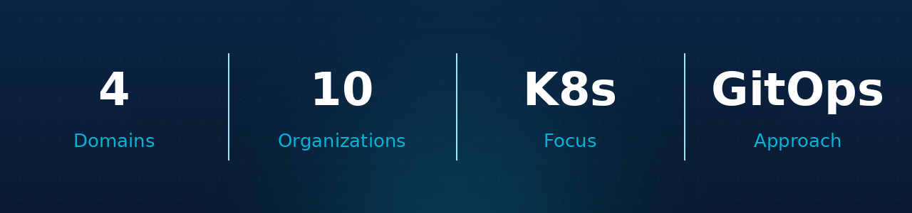
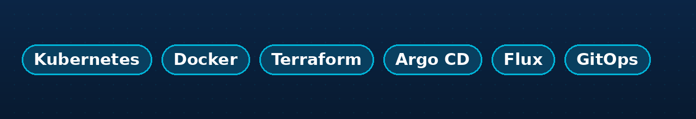

## Focus

I build and harden cloud-native platforms — upstream Kubernetes, declarative
delivery, and the guardrails that keep them safe to run. I care about systems that
scale and are governed by default.

## Domains

| Area | What I work on | Where |
|---|---|---|
| **Kubernetes** | Building and hardening upstream clusters | [10-vanilla-k8s-and-hardening](https://github.com/10-vanilla-k8s-and-hardening) |
| **GitOps** | Declarative delivery with Argo CD and Flux | [30-gitops-argocd-flux](https://github.com/30-gitops-argocd-flux) |
| **Automation** | Cluster lifecycle and day-2 operations | [40-cluster-automation](https://github.com/40-cluster-automation) |
| **AI infrastructure** | Governance and cost-efficient inference | [org-ai-governance](https://github.com/org-ai-governance) |

## Organizations

## Contact

---

Platform engineering, cloud-native operations, and AI infrastructure. Reach out
if you are hiring or want to talk infrastructure.
